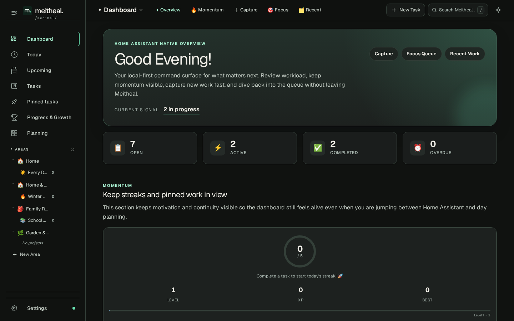
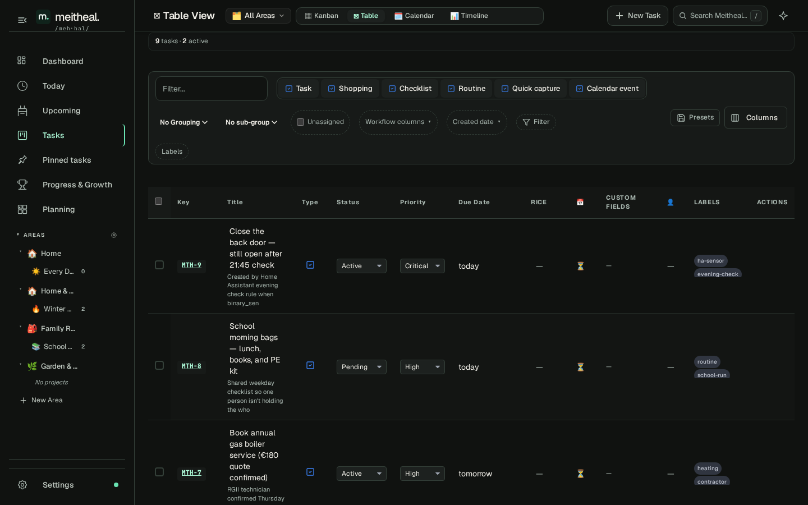

# Meitheal

> The Home Assistant-native execution hub for your house, your homelab, and the plans that keep both moving.

## What Meitheal Is

Meitheal (pronounced "meh-hal") takes its name from the old Irish idea of neighbors showing up together to get real work done.

That is the product idea here too.

Meitheal started as a task list inside Home Assistant. It has grown into a local-first coordination layer for the practical work of running a home, a family, or a homelab: capturing tasks, deciding what matters now, connecting work to calendars and automations, and keeping that context available through the Home Assistant dashboard, companion app, voice assistants, and AI agents.

If Grocy helps answer "what do I have?" and "what needs tracking?", Meitheal helps answer "what should happen next?", "who owns it?", and "how do we keep it moving without more overhead?"

## Why It Lives Inside Home Assistant

- It works where many self-hosters already live: the Home Assistant sidebar, companion app, automations, and voice stack.
- It stays local-first: Astro SSR, SQLite, Home Assistant ingress, and no required cloud service.
- It can connect work to the rest of the house: todo entities, calendars, notifications, sensors, services, webhooks, and companion shortcuts.
- It supports both human and agent workflows without asking you to leave your Home Assistant environment.

## What You Can Do With It

### Capture and clarify work

- Capture tasks quickly from the dashboard, Today view, task modal, templates, Assist, or automation flows.
- Use descriptions, checklists, recurrence, labels, due dates, favorites, saved filters, and task links to keep work actionable instead of vague.
- Triage carried-forward work, pin the most important tasks, and surface suggested work for the day.

### Work the way your brain works

- Move between Dashboard, Today, Kanban, Table, Upcoming, Calendar, Projects, Goals, Habits, Gamification, Review, Timeline, and Settings.
- Use the shared SearchHub to jump between tasks, views, settings, saved filters, and high-value actions.
- Keep daily work simple when you want it simple, or go deep with strategy lenses, custom fields, rules, and review flows when you want more structure.

### Keep plans connected to the home

- Sync with Home Assistant todo entities and calendar entities.
- Trigger HA automations from task events and push overdue reminders through Home Assistant notifications.
- Bring companion app shortcuts, x-callback-url flows, and installable PWA behavior into the same system.
- Connect to Grocy, Node-RED, n8n, and compatibility layers without turning Meitheal into a cloud SaaS clone.

### Stay available everywhere

- Use the searchable Settings shell to manage integrations, AI, PWA, automation, and system trust surfaces from one place.
- Install it as a PWA, keep working offline, and sync back when connectivity returns.
- Export your data as JSON, CSV, or SQLite, and use built-in backup flows so your planning system stays portable.

### Work with voice and agents

- Use Home Assistant Assist for built-in task actions.
- Expose Meitheal to conversation agents through the Home Assistant LLM API.
- Use the Astro MCP surface, the Home Assistant custom-component MCP surface, A2A discovery, and the experimental WebMCP track for agent workflows.
- Keep human control in the loop while the repo evolves toward richer review and handoff semantics.

## Ubiquitous Language

Meitheal is in a transitional language phase.

The canonical model is:

| Term | Meaning |
|------|---------|
| Area | A life or operating domain such as Home, Work, Family, or Homelab |
| Goal | An outcome you are trying to move toward |
| Project | A bounded body of work in service of a goal |
| Task | A concrete unit of work |
| Routine | Repeatable work that spawns routine instances over time |

Compatibility note:

- Some current UI, API, and integration surfaces still expose legacy board, `task_type`, or `Epic/Story` language.
- Vikunja compatibility and older task views still carry some of that vocabulary by design.
- This README uses the newer model as the clearest way to explain Meitheal today, and calls out compatibility terms only where they matter.

## Screenshots

| Dashboard | Work View | Settings |
|-----------|-----------|----------|
|  |  |  |

## Quick Install on Home Assistant

1. Open **Settings** → **Add-ons** → **Add-on Store** → **⋮** → **Repositories**
2. Add `https://github.com/Coolock-Village/meitheal`
3. Install **Meitheal**
4. Start the add-on
5. Open the Web UI

If you want the detailed add-on flow, companion setup, and automation notes, start with `meitheal-hub/DOCS.md`.

## Voice and AI Quick Start

1. Install and start the add-on so Home Assistant can discover the Meitheal integration.
2. In **Settings → Devices & Services**, confirm the Meitheal integration is loaded.
3. In **Settings → Voice Assistants → [Your Agent] → Configure → LLM APIs**, select **Meitheal Tasks** if you want conversation-agent tooling.
4. In **Settings → Voice Assistants → Expose**, expose `todo.meitheal_tasks` so built-in Assist intents can see your task list.

Built-in Assist commands work even without an LLM. The LLM API adds a richer task, hierarchy, and planning surface on top.

## Architecture at a Glance

| Layer | Stack |
|-------|-------|
| Runtime | Home Assistant add-on + Astro SSR |
| Persistence | SQLite via libSQL + Drizzle-backed repositories |
| Architecture | Domain-driven monorepo with package domains and in-app domains |
| Frontend | Astro-first UI with client controllers, PWA support, and ingress-safe behavior |
| Integrations | Home Assistant, calendars, todo, Grocy, webhooks, companion, MCP/A2A/LLM |
| Principles | Local-first, Home Assistant-native, Astro-first, KCS-aware |

## Documentation Map

- `meitheal-hub/DOCS.md` — install, add-on behavior, voice, security, publishing notes
- `WEBMCP.md` — agent protocol overview and route surface
- `docs/companion-app-setup.md` — mobile, Siri, shortcuts, widgets, and companion flows
- `docs/kcs/pwa-offline-guide.md` — offline behavior, caching, installability, ingress-safe PWA notes
- `docs/kcs/search-hub-guide.md` — SearchHub scopes and task-search parity
- `public/llms.txt` and `public/llms-full.txt` — machine-readable product and protocol summaries

## Non-Negotiables

- Astro-first architecture
- Home Assistant add-on compatibility
- Strict DDD boundaries and ubiquitous language
- KCS updates alongside behavior changes
- Local-first operation and no required cloud dependency

## Legal and Licensing

Meitheal uses a dual-licensing model.

| Scope | License |
|-------|---------|
| Core application (`apps/`, `packages/`, `meitheal-hub/`) | [AGPL-3.0](LICENSE) + commercial option |
| Home Assistant integration | [Apache 2.0](integrations/home-assistant/LICENSE) |
| Node-RED integration | [Apache 2.0](integrations/nodered/LICENSE) |
| Vikunja compatibility layer | AGPL-3.0 only |

If you are embedding Meitheal in commercial or proprietary software, see [COMMERCIAL.md](COMMERCIAL.md).
