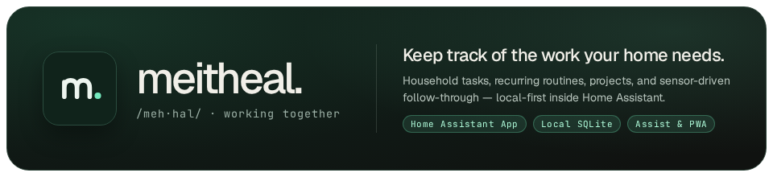
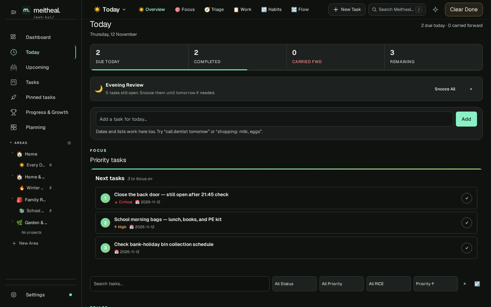
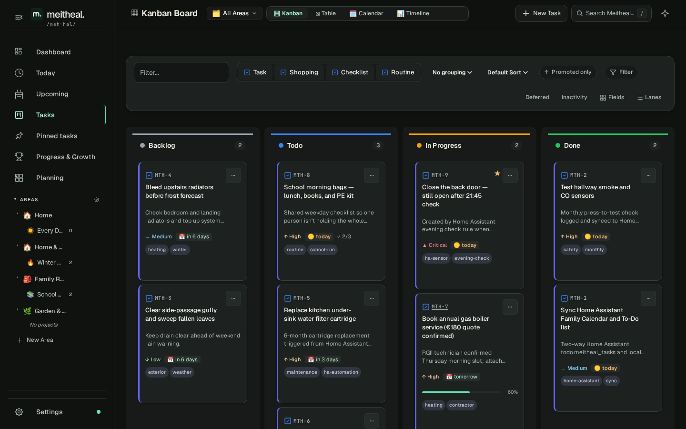
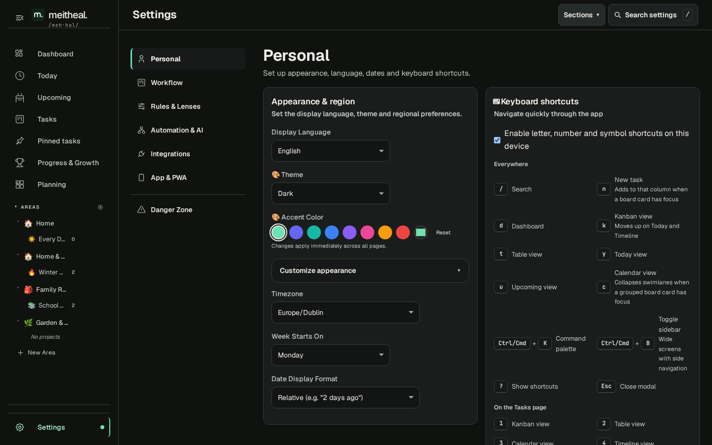

# Meitheal

[meitheal.io](https://meitheal.io) · [Install status](https://github.com/ryan-winkler/meitheal-ha-addon/issues/1) · [Create your first task](docs/first-task.md) · [Get help](SUPPORT.md)

**Meitheal** (`/meh·hal/`) is an Irish word for neighbors coming together to share the work that no single person should have to carry alone.

In your smart home, **Meitheal keeps track of the work your home needs.** Home Assistant already knows when the back door is still open at night, when the under-sink water filter reaches six months, or when a frost warning is due. Meitheal turns those signals — alongside recurring family routines, seasonal maintenance, and multi-step household projects — into one calm, local-first execution hub in your Home Assistant sidebar, stored in SQLite on your own hardware.

## Built for how a real household runs

Most homes have one person quietly holding the invisible mental ledger: boiler servicing, school morning bags, bank-holiday bin changes, smoke-sensor checks, and half-finished weekend repairs. Chat reminders scroll away; corporate project trackers feel like bringing work home.

Meitheal sits naturally between **Home Assistant automations** and **everyday household follow-through**:

| Your Rule or Rhythm | The Task in Meitheal | How Your Household Follows Through |
|---|---|---|
| `binary_sensor.back_door` stays open past `21:45` | **Close the back door — still open after 21:45 check** (`Critical`, tagged `ha-sensor`) | Appears at the top of **Today** and `todo.meitheal_tasks` until someone latches it |
| Weekday `07:00` routine template | **School morning bags — lunch, books, and PE kit** (with 3-step checklist) | Anyone at home can check off what is packed from the kitchen tablet or phone |
| 180-day Home Assistant counter | **Replace kitchen under-sink water filter cartridge** | Lands in **Upcoming** and syncs to your Home Assistant calendar before it is overdue |
| Multi-step seasonal prep | **Winter Boiler and Heating Prep** project | Tracks contractor quotes, radiator bleeding, and pressure checks in **Kanban** or **Table** |

- **Start in Today**: Review due work, recurring routines, carried-forward items, and evening wrap-up in one focused view.
- **Plan at the right altitude**: Switch between **Kanban**, **Table**, **Calendar**, and **Timeline**, or search everything instantly via [Search Hub](docs/kcs/search-hub-guide.md) (`/` or `Ctrl/Cmd + K`).
- **Stay inside Home Assistant**: Two-way calendar and `todo.meitheal_tasks` sync, Home Assistant sensors and services, Assist voice intents, webhooks, and scoped LLM/MCP agent tokens.
- **Use on any screen — even offline**: Open through Home Assistant Ingress, launch via Companion deep links, or [install the PWA](docs/kcs/pwa-offline-guide.md) with offline task queuing.
- **Own your data completely**: Local SQLite database covered by [Home Assistant backups](docs/kcs/home-assistant-backup-and-restore.md), plus one-click JSON, CSV, and raw SQLite exports.

## Inside Meitheal

| Today — Daily Focus & Routines | Household Dashboard & Focus Queue |
|---|---|
|  |  |
| **Kanban & Project Board** | **Home Assistant-Native Settings** |
|  |  |

Additional views include structured [Table planning](docs/screenshots/table.png) and month-grid [Calendar scheduling](docs/screenshots/tasks.png).

## Ubiquitous Language

Use these terms when you plan work in Meitheal:

| Term | Meaning |
|------|---------|
| Pillar | A permanent, identity-based motivational anchor — the WHY behind Goals and Routines (e.g. Safe & Warm Home, Physical Longevity) |
| Principle | A behavioral boundary within a Pillar — the Non-Negotiable rules (e.g. "Keep household data local", "No screens after 9 PM") |
| Area | A life or operating domain such as Home & Safety, Family Routines, Garden, or Homelab |
| Goal | An outcome you are trying to move toward |
| Project | A bounded body of work in service of a goal (e.g. Winter Boiler and Heating Prep) |
| Task | A concrete unit of work with optional checklists, priority, effort, and Home Assistant metadata |
| Routine | Repeatable work that spawns real task instances on a daily or weekly cadence |

Some older views and integrations use earlier names. The [glossary](docs/kcs/hierarchy-glossary.md) explains the current model.

## Quick Install on Home Assistant

Check [installation availability](https://github.com/ryan-winkler/meitheal-ha-addon/issues/1) before you start.

1. Open **Settings → Apps → Install app** in Home Assistant (called **Add-ons → Add-on Store** in earlier Home Assistant releases).
2. Open the top-right **⋮** menu and select **Repositories**.
3. Add `https://github.com/ryan-winkler/meitheal-ha-addon`.
4. Select **Meitheal** (or **Meitheal Canary** to preview upcoming builds).
5. Select **Install**, then **Start**, and enable **Show in sidebar** if desired.
6. Select **Open web UI**.

See the [add-on setup guide](meitheal-hub/DOCS.md) and [Canary guide](meitheal-hub-canary/DOCS.md) for full configuration and backup notes.

## Two-Repository Architecture

Meitheal uses two linked repositories so Home Assistant appliances stay fast and lightweight during Store refreshes:

| Repository | Purpose | Contents | Who Uses It |
|---|---|---|---|
| **[meitheal](https://github.com/ryan-winkler/meitheal)** (this repo) | Application source & CI | Astro SSR web app, DDD domain packages, E2E test suites, Dockerfiles, and release pipelines (`dev` is the default branch). | Contributors, reviewers, and CI/CD pipelines. |
| **[meitheal-ha-addon](https://github.com/ryan-winkler/meitheal-ha-addon)** | Home Assistant App Store catalog | Lightweight Store manifests (`config.yaml`), brand icons, translations, screenshots, and setup guides (~2 MB). | Home Assistant Supervisor & users installing Meitheal. |

**Why retain `meitheal-ha-addon` separately?**  
Home Assistant Supervisor clones the full Git repository onto user hardware when adding a store URL and runs `git pull` on every Store refresh. Keeping `meitheal-ha-addon` lightweight stops low-memory devices (such as Home Assistant Green or Raspberry Pi) from downloading full monorepo history, packages, and test suites just to check for add-on updates.

## Try Meitheal from Source

Follow the [local setup](CONTRIBUTING.md#run-and-verify-locally) to open Meitheal in your browser and create a task with a disposable SQLite database. Use Home Assistant or the checked-in devcontainer for voice, companion app, ingress, and automation features.

## Connect Home Assistant Assist & Automations

The optional Home Assistant custom integration adds `todo.meitheal_tasks`, task count sensors, and native automation actions. Set it up once the add-on is running:

1. Install the [Meitheal integration](docs/kcs/home-assistant-marketplace.md).
2. Open **Settings → Devices & Services** in Home Assistant and configure the discovered **Meitheal** entry.
3. Enter a scoped Meitheal agent token when prompted (**Settings → Automation & AI** inside Meitheal).
4. In **Settings → Voice assistants → Expose**, choose whether Assist can use `todo.meitheal_tasks`. Grant **Read Tasks** and **Create & Update Tasks** for voice capture and completion.

On Home Assistant Core 2026.11 or later, an active administrator can also enable **Meitheal Tasks (read only)** in a conversation agent's LLM API settings to search and summarize tasks safely. External automation tools (n8n, Node-RED, MCP clients) can use separate scoped tokens.

[Integration credentials](docs/kcs/home-assistant-core-credentials.md) · [Agent & MCP guide](WEBMCP.md)

## Architecture at a Glance

| Layer | Stack |
|-------|-------|
| Runtime | Astro SSR web application running as a Home Assistant add-on behind Supervisor Ingress |
| Persistence | Local SQLite storage (`/data/meitheal.db`) via Drizzle repositories |
| Domain Model | Bounded DDD packages (`domain-auth`, `domain-tasks`, `domain-strategy`, `domain-observability`, `integration-core`) |
| Interface | Accessible dark & light themes (`Geist Variable` + `JetBrains Mono`), installable PWA, and keyboard-first navigation |
| Integrations | Home Assistant WebSocket/REST, calendars, `todo.meitheal_tasks`, Grocy, webhooks, A2A, and OpenAPI-driven MCP tools |
| Deployment | Multi-arch (`amd64`, `aarch64`) container on the same host as Home Assistant with AppArmor isolation |

## Documentation Map

- [Create your first task](docs/first-task.md)
- [Set up the Home Assistant add-on](meitheal-hub/DOCS.md)
- [Open Meitheal in the Home Assistant Companion app](docs/companion-app-setup.md)
- [Install the web app and use it offline](docs/kcs/pwa-offline-guide.md)
- [Find tasks, views, and settings with Search Hub](docs/kcs/search-hub-guide.md)
- [Design system, brand tokens, and appearance](DESIGN.md)
- [Browse all operational and KCS guides](docs/index.md)

## Non-Negotiables

- Keep household data local on hardware you control.
- Make the Home Assistant Ingress and Companion path work first.
- Keep data portable through Home Assistant backups and open exports.
- Update the user guide in the same change whenever workflows evolve.

## Contribute and Get Help

- [Contribute a change](CONTRIBUTING.md)
- [Use automations and agents with Meitheal](docs/kcs/agent-automation-guide.md)
- [Community conduct](CODE_OF_CONDUCT.md)
- [Support](SUPPORT.md)
- [Report a security problem privately](SECURITY.md)

## Supporting Meitheal

Meitheal is independent and community-driven. Financial support helps fund infrastructure, accessibility testing, hardware qualification, and continuous development:

- [GitHub Sponsors](https://github.com/sponsors/ryan-winkler)
- [Ko-fi](https://ko-fi.com/ryanw_eu)
- [Revolut](https://revolut.me/ryanwi)
- [Polar](https://polar.sh/Coolock-Village)

## Legal and Licensing

Meitheal is source-available. Use it at home or inside your organisation. Keep attribution when you share it, and offer changes upstream even if you use them only inside your organisation. The [license](LICENSE) sets the conditions and restrictions on paid copies, access, and services. See [business use](COMMERCIAL.md) for examples. The optional [Home Assistant integration](integrations/home-assistant/LICENSE) and [automation integration](integrations/nodered/LICENSE) have separate licenses. The compatibility API remains separately licensed and outside this release. The [distribution license](https://github.com/ryan-winkler/meitheal-ha-addon/blob/main/LICENSE) covers published add-on images.
