

  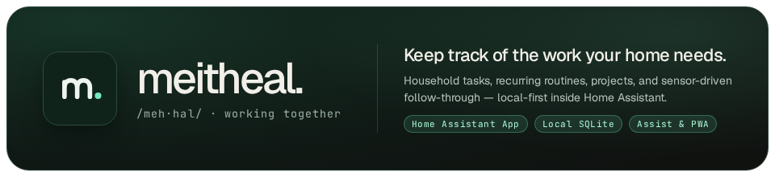

  
  
  
  
  
  
  
  

  A local-first household task hub for Home Assistant: Today, Upcoming, Boards, 
  Calendar, Timeline, and planning modes in one install. 
  Simple enough for everyone at home. Wired directly to Home Assistant automations, Assist, and local SQLite.

  <a href="#installation">Install</a> · <a href="#a-look-around">Screenshots</a> · <a href="#themes">Themes</a> · <a href="#features">Features</a> · <a href="#home-assistant-automations-and-assist">Automations</a> · <a href="#documentation">Docs</a> · <a href="#sponsors">Sponsors</a> · <a href="SUPPORT.md">Support</a>

  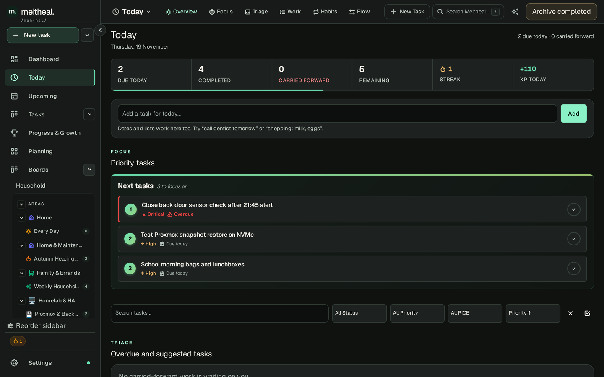

**Meitheal** (`/meh·hal/`) is an Irish word for neighbors coming together to share work that no single person should carry alone. It runs inside your Home Assistant sidebar, stores everything in a local SQLite database on your own hardware, and has no cloud account or subscription.

---

## A look around

### Today, Upcoming, and Dashboard

Start every morning in **Today** for due work, streaks, and quick capture, look ahead seven days in **Upcoming**, or check overall household momentum on the configurable **Dashboard**.

<table>
  <tr>
    <td width="50%"> <b>Today</b>: priority stack, natural-language quick add, daily stats, and carried-forward triage</td>
    <td width="50%">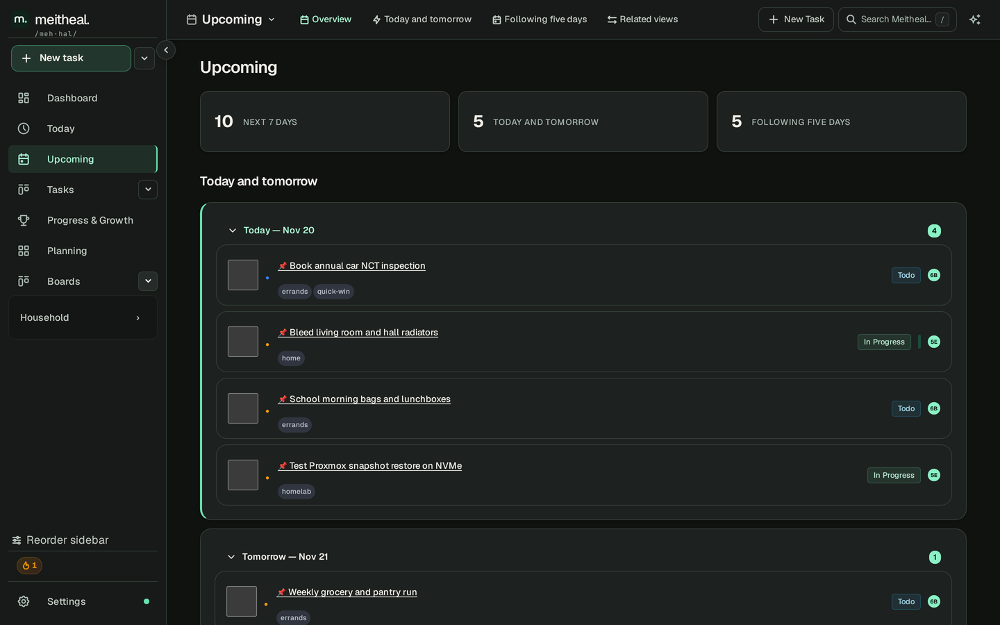 <b>Upcoming</b>: 7-day lookahead grouped into Today, Tomorrow, and the week ahead</td>
  </tr>
  <tr>
    <td width="50%">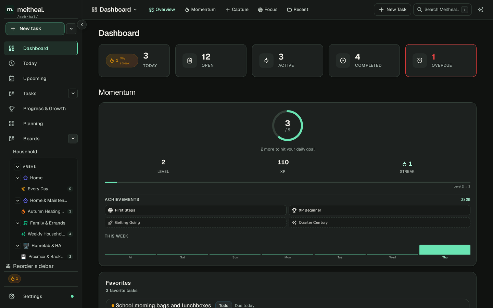 <b>Dashboard</b>: configurable overview with momentum ring, XP streak, and overdue alerts</td>
    <td width="50%" align="center">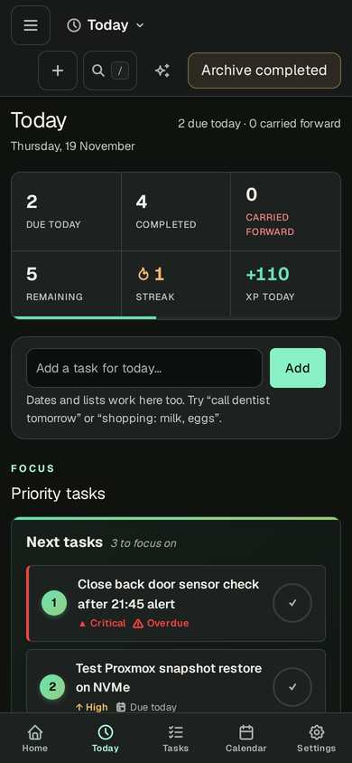 <b>On a phone</b>: installable PWA with offline queuing and mobile-first Today stats</td>
  </tr>
</table>

  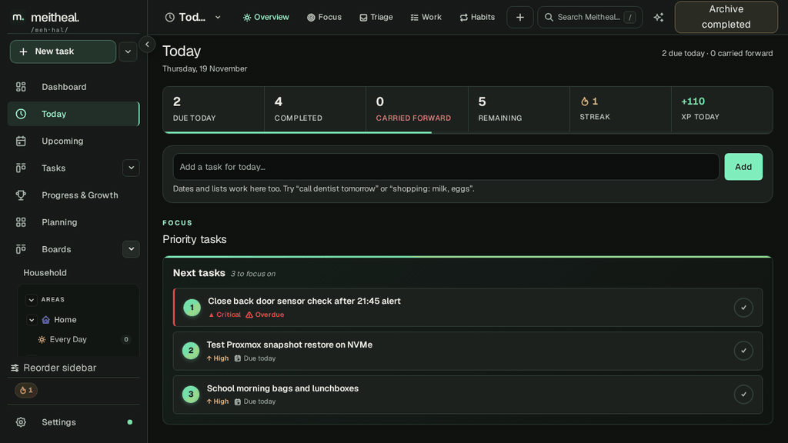 
  <b>Quick add and check off</b>: natural-language dates, priorities, and one-tap completion in Today

### Boards and views

Keep one household task list and view it however fits the job: drag cards on **Kanban**, filter and sort in **Table**, check dates on **Calendar**, or map multi-day work on **Timeline**.

<table>
  <tr>
    <td width="50%">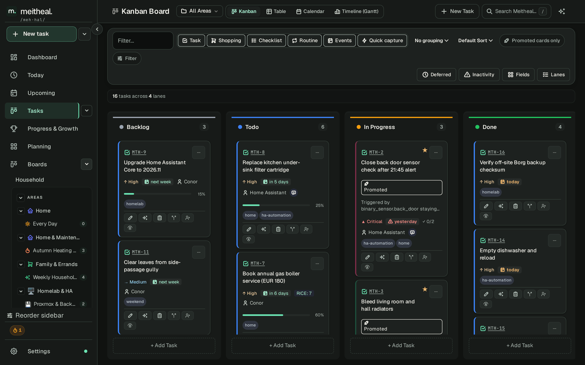 <b>Kanban</b>: drag cards across lanes with color-tinted Promoted cards</td>
    <td width="50%">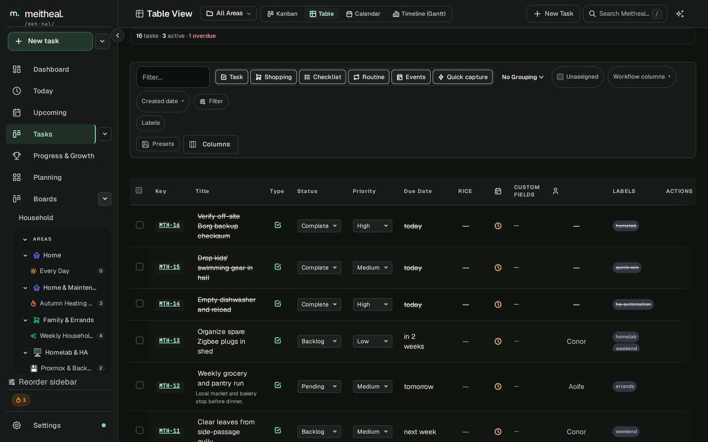 <b>Table</b>: sortable columns for status, priority, due date, and assignee</td>
  </tr>
  <tr>
    <td width="50%">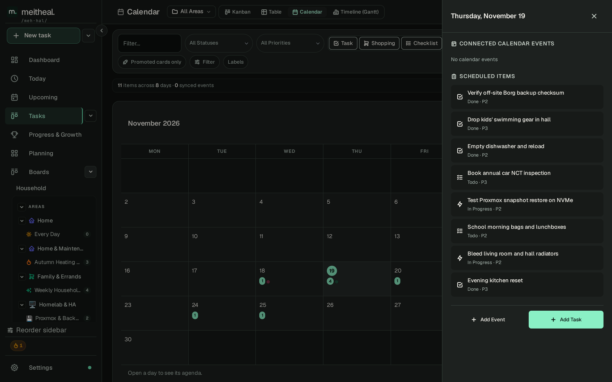 <b>Calendar</b>: month grid with a slide-over day agenda drawer</td>
    <td width="50%">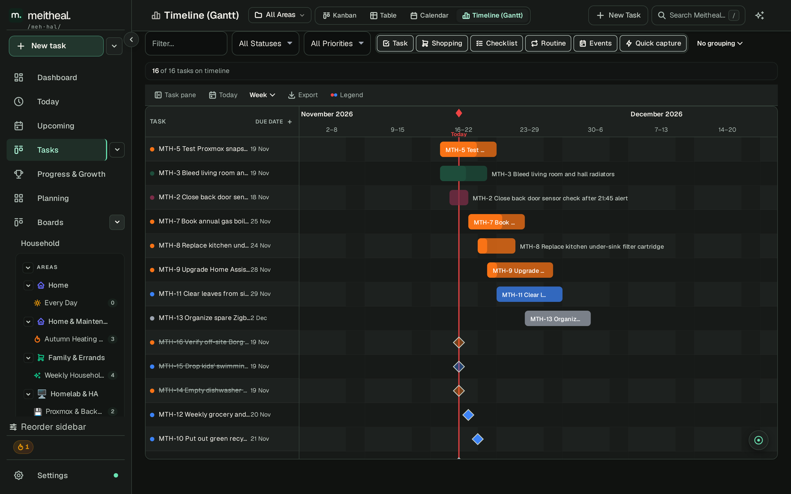 <b>Timeline (Gantt)</b>: multi-day household projects and maintenance windows</td>
  </tr>
</table>

  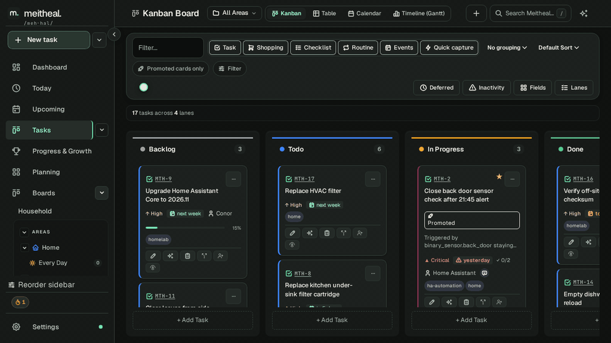 
  <b>One list, every view</b>: drag a card on Kanban, then switch straight to Table, Calendar, and Timeline

### Planning modes

When the backlog grows, switch into structured planning without leaving Home Assistant: sort urgency and importance in the **Eisenhower Matrix**, process incoming work in **Triage**, rank impact with **RICE**, or expand any task into distraction-free **Focus Mode**.

<table>
  <tr>
    <td width="50%">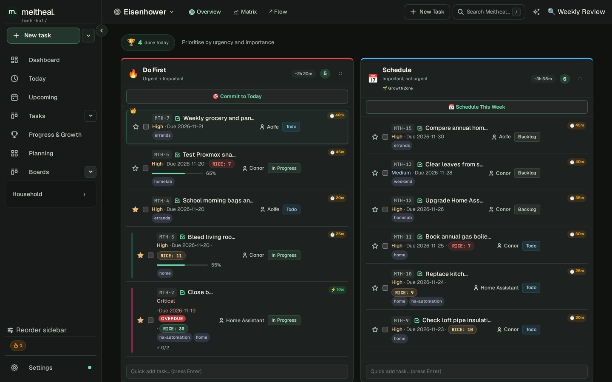 <b>Eisenhower Matrix</b>: classify tasks into Do First, Schedule, Delegate, and Not Now</td>
    <td width="50%">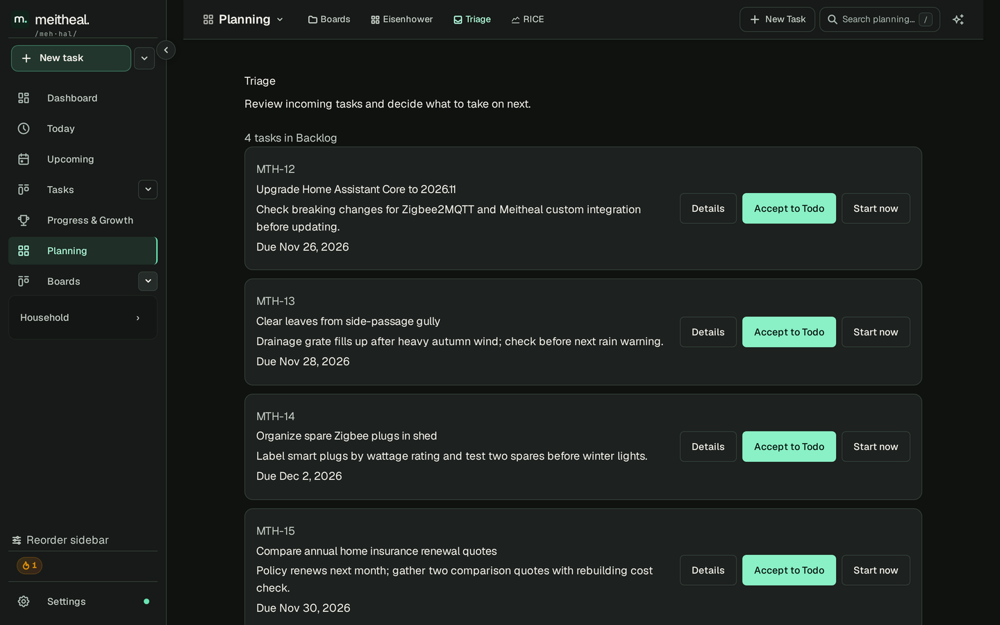 <b>Triage</b>: review incoming backlog items and accept, start, or defer them in one pass</td>
  </tr>
  <tr>
    <td width="50%">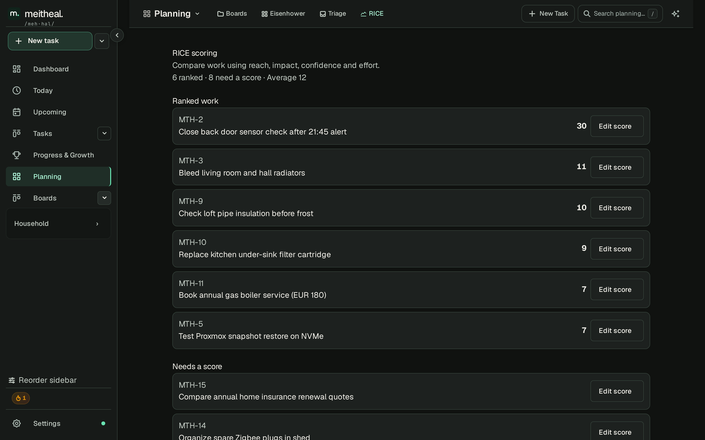 <b>RICE Scoring</b>: rank household projects by Reach, Impact, Confidence, and Effort</td>
    <td width="50%">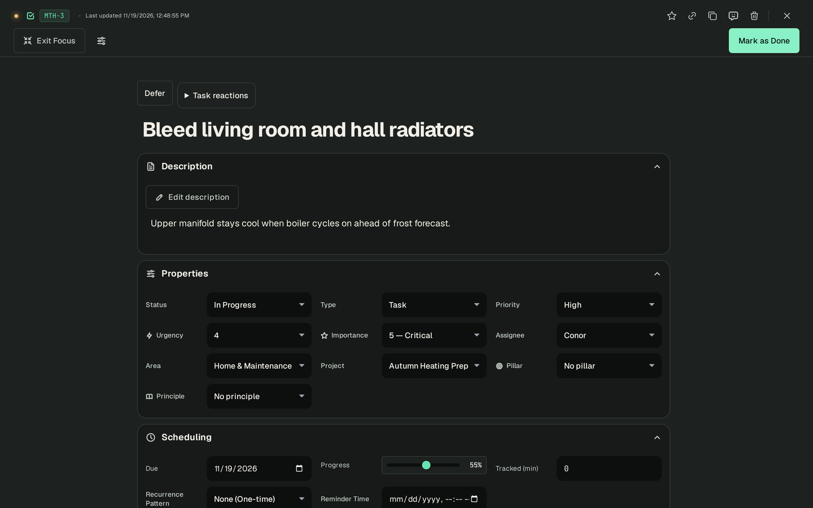 <b>Focus Mode</b>: distraction-free task detail with checklists, RICE scoring, and Auto-score with Assist</td>
  </tr>
</table>

  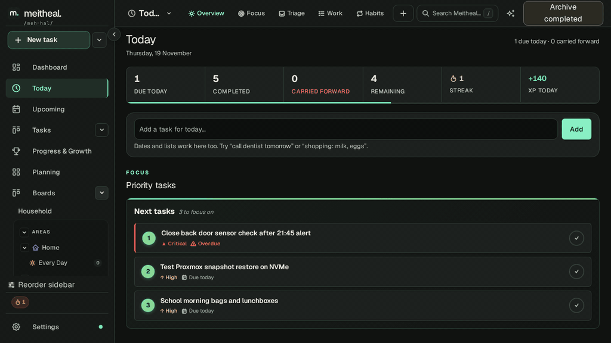 
  <b>Search Hub to Focus Mode</b>: press <code>/</code> or <code>Ctrl/Cmd + K</code> to jump to any task, board, action, or setting

### Home Assistant automations and Assist

Home Assistant already knows when a door is left open, when a filter hits 180 days, or when a frost warning arrives. Meitheal turns those triggers into trackable tasks anyone at home can finish:

| Your Rule or Rhythm | Task Created in Meitheal | How Your Household Follows Through |
|---|---|---|
| `binary_sensor.back_door` stays open past `21:45` | **Close back door sensor check after 21:45 alert** (`Critical`, `ha-automation`) | Appears at the top of **Today** and `todo.meitheal_tasks` until someone latches it |
| Weekday `07:00` routine template | **School morning bags and lunchboxes** (with 3-step checklist) | Anyone at home ticks off packed items from a kitchen tablet or phone |
| 180-day Home Assistant counter | **Replace kitchen under-sink filter cartridge** | Lands in **Upcoming** and syncs to your Home Assistant calendar before it is overdue |
| Multi-step seasonal prep | **Autumn Heating Prep** project | Tracks boiler quotes, radiator bleeding, and pressure checks in **Kanban** or **Timeline** |

  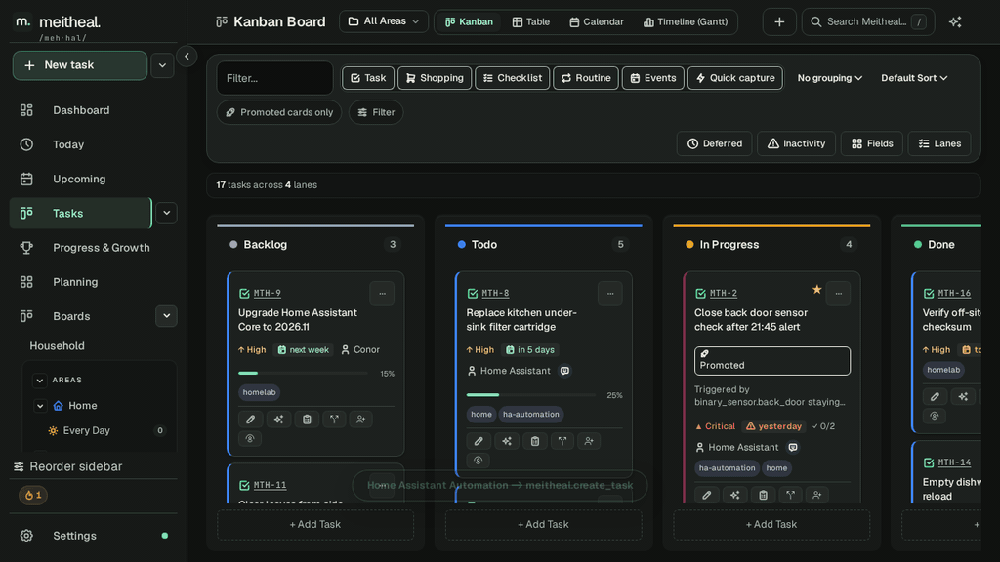 
  <b>Sensor to task</b>: a Home Assistant automation creates a task in local SQLite, promotes it on the Board, and surfaces it in Eisenhower

---

## Themes

Choose from 12 built-in presets (**Auto**, **Paper Emerald**, **Zen Paper**, **Catppuccin Latte**, **Nordic Frost**, **Solarized Dawn**, **Emerald Isle**, **Knight Rider**, **Plainspace**, **Velvet**, **Liquid Glass**, and **Rainbow**), pick a personal accent swatch or custom hex color, upload custom CSS ([custom theme guide](docs/kcs/custom-themes.md)), or enable **Match Home Assistant theme** so Meitheal follows your Home Assistant dashboard automatically.

<table>
  <tr>
    <td width="50%"> <b>Emerald Isle</b>: Evergreen Carbon dark with Living Mint accent (default)</td>
    <td width="50%">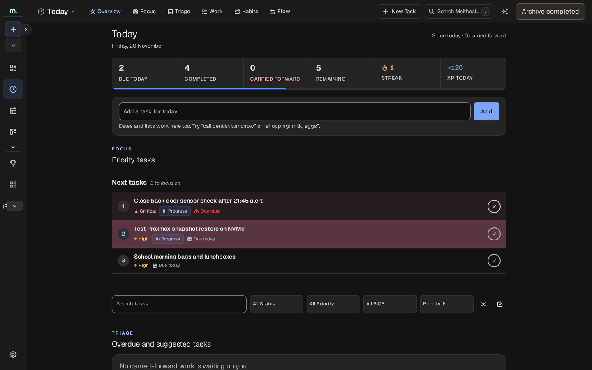 <b>Knight Rider</b>: matte obsidian dark with high-contrast slate accents and compact sidebar</td>
  </tr>
  <tr>
    <td width="50%">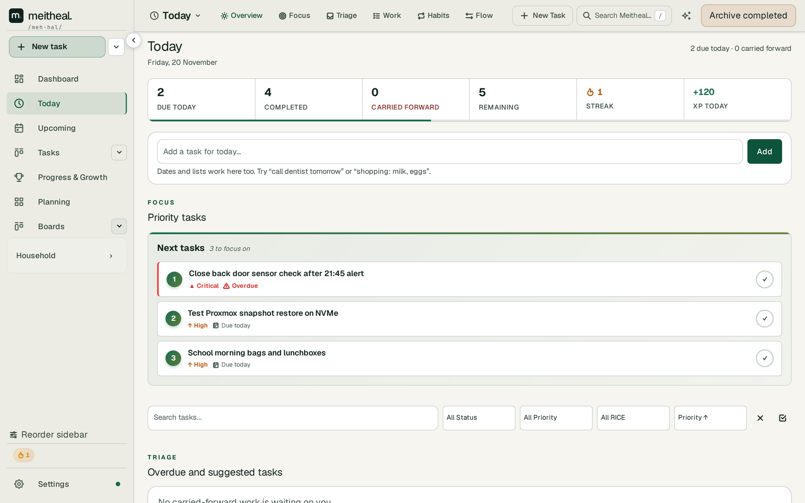 <b>Light</b>: Warm Paper high-contrast light surfaces for bright rooms and wall tablets</td>
    <td width="50%">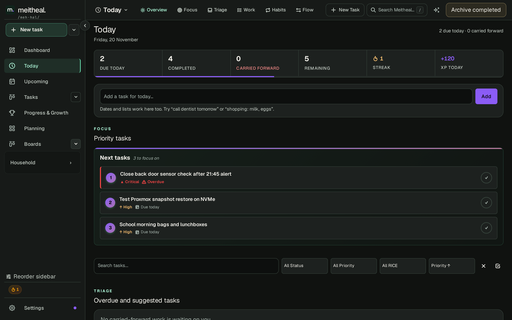 <b>Custom accent</b>: pick any built-in swatch or custom hex color (shown in Violet)</td>
  </tr>
  <tr>
    <td width="50%">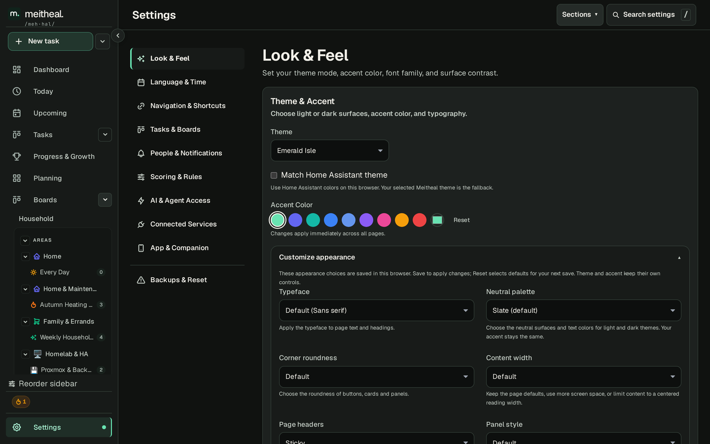 <b>Look &amp; Feel settings</b>: theme picker, Match Home Assistant theme, accent swatches, and custom CSS</td>
    <td width="50%">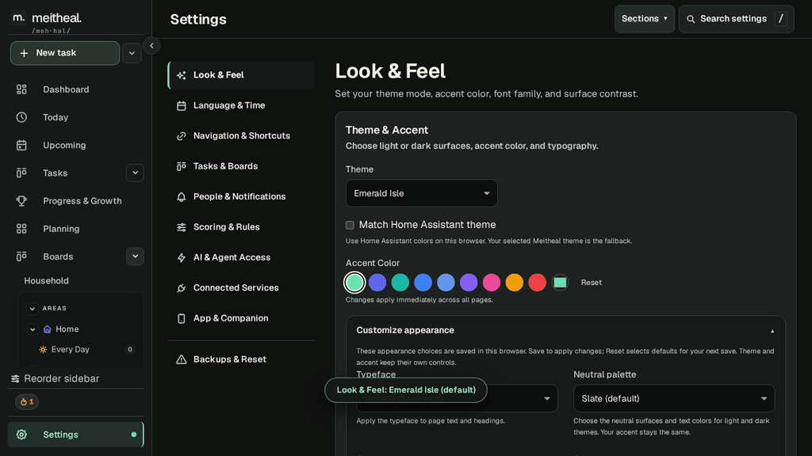 <b>Live switching</b>: theme and accent changes apply across the app immediately</td>
  </tr>
</table>

---

## Features

**Today & Upcoming**
- Priority focus stack, carried-forward triage, natural-language quick capture, daily checklists, recurring routines, and streaks.
- 7-day **Upcoming** schedule grouped into Today, Tomorrow, and the five days ahead.
- Configurable **Dashboard** with momentum ring, XP streak, open/overdue counts, and achievements.

**Boards & Views**
- Shared household Boards and private personal Boards with scoped permissions and recoverable Board removal.
- Switch the same tasks across **Kanban** (drag-and-drop with Promoted cards), **Table**, **Calendar** (with day agenda drawer), and **Timeline (Gantt)**.
- Keyboard-first [Search Hub](docs/kcs/search-hub-guide.md) (`/` or `Ctrl/Cmd + K`) for tasks, views, quick actions, and settings.

**Planning Modes & Household Hierarchy**
- **Eisenhower Matrix** (Do First, Schedule, Delegate, Not Now), **Triage** backlog intake, **RICE** scoring, and distraction-free **Focus Mode** with **Auto-score with Assist**.
- Optional structured hierarchy: **Pillars** (why it matters) -> **Principles** (non-negotiables) -> **Areas** -> **Goals** -> **Projects** -> **Tasks** and **Routines**. See the [hierarchy glossary](docs/kcs/hierarchy-glossary.md).

**Home Assistant, Assist & Automations**
- Native Home Assistant Ingress sidebar app with Companion app deep links.
- Optional custom integration adding `todo.meitheal_tasks`, two-way calendar sync, task count sensors, and native Home Assistant actions.
- Expose tasks to **Assist** voice commands, or enable **Meitheal Tasks (read only)** in Home Assistant Core 2026.11+ conversation agents.
- Scoped API tokens for webhooks, n8n, Node-RED, Grocy, A2A, and OpenAPI-driven MCP tools ([agent & MCP guide](WEBMCP.md)).

**Themes, Accessibility & Offline Mobile**
- Emerald Isle, Knight Rider, Light, Auto (System), custom accents, custom CSS, and **Match Home Assistant theme**.
- [Installable PWA](docs/kcs/pwa-offline-guide.md) with offline task queuing, keyboard navigation, and accessible contrast.

**Local Data & Backups**
- Everything lives in local SQLite (`/data/meitheal.db`) on your Home Assistant host.
- Covered automatically by [Home Assistant backups](docs/kcs/home-assistant-backup-and-restore.md), plus one-click JSON, CSV, and raw SQLite exports.

---

## Installation

### 1. Install the Home Assistant App (recommended)

1. Open **Settings -> Apps -> Install app** in Home Assistant (called **Add-ons -> Add-on Store** on earlier releases).
2. Open the top-right **⋮** menu and select **Repositories**.
3. Add `https://github.com/ryan-winkler/meitheal-ha-addon`.
4. Select **Meitheal** (or **Meitheal Canary** for continuous `dev` previews).
5. Select **Install**, then **Start**, and enable **Show in sidebar**.
6. Select **Open web UI**.

See the [add-on setup guide](meitheal-hub/DOCS.md) and [Canary guide](meitheal-hub-canary/DOCS.md) for configuration and backup details.

### 2. Optional: Connect Home Assistant Assist & Automations

1. Install the [Meitheal custom integration](docs/kcs/home-assistant-marketplace.md).
2. Open **Settings -> Devices & Services** in Home Assistant and configure the discovered **Meitheal** entry.
3. Paste a scoped token from **Settings -> AI & Agent Access** inside Meitheal ([integration credentials](docs/kcs/home-assistant-core-credentials.md)).
4. In **Settings -> Voice assistants -> Expose**, expose `todo.meitheal_tasks` if you want Assist voice capture and completion.

### 3. Try from source

Follow the [local setup](CONTRIBUTING.md#run-and-verify-locally) to run Meitheal locally with a disposable SQLite database, or use the checked-in devcontainer for Home Assistant Ingress and automation work.

---

## Architecture & Two-Repository Setup

Meitheal splits application source from Store manifests so low-memory Home Assistant appliances (such as Home Assistant Green or Raspberry Pi) only pull ~2 MB during Store refreshes instead of full monorepo history and tests:

| Repository | Purpose | Contents |
|---|---|---|
| **[meitheal](https://github.com/ryan-winkler/meitheal)** (this repo) | Application source & CI | Astro SSR app, DDD domain packages, Playwright & pytest suites, Dockerfiles (`dev` is default) |
| **[meitheal-ha-addon](https://github.com/ryan-winkler/meitheal-ha-addon)** | Home Assistant App Store catalog | Store manifests (`config.yaml`), brand icons, translations, screenshots, and setup guides (~2 MB) |

| Layer | Stack |
|---|---|
| Runtime | Astro SSR running as a multi-arch (`amd64`, `aarch64`) Home Assistant app behind Supervisor Ingress with AppArmor |
| Persistence | Local SQLite (`/data/meitheal.db`) via Node.js built-in `node:sqlite` (`DatabaseSync`) |
| Domain Model | Bounded DDD packages (`domain-auth`, `domain-tasks`, `domain-strategy`, `domain-observability`, `integration-core`) |
| Integrations | Home Assistant WebSocket/REST, calendars, `todo.meitheal_tasks`, Grocy, webhooks, A2A, and MCP |

---

## Documentation

- [Create your first task](docs/first-task.md)
- [Home Assistant add-on setup](meitheal-hub/DOCS.md) · [Companion app setup](docs/companion-app-setup.md)
- [PWA & offline usage](docs/kcs/pwa-offline-guide.md) · [Search Hub guide](docs/kcs/search-hub-guide.md)
- [Automations & agents](docs/kcs/agent-automation-guide.md) · [WebMCP & MCP guide](WEBMCP.md) · [Plugin development guide](docs/kcs/plugin-development.md)
- [Design system & appearance](DESIGN.md) · [Architecture overview](docs/architecture.md) · [Security assurance case](docs/security-assurance-case.md)
- [Browse all KCS guides & runbooks](docs/index.md)

---

## Contribute, Support & How It's Built

- [Contributing guide](CONTRIBUTING.md) · [Governance](GOVERNANCE.md) · [Roadmap](ROADMAP.md) · [Code of Conduct](CODE_OF_CONDUCT.md)
- [Get help](SUPPORT.md) · [Report a security problem privately](SECURITY.md)

Maintainers guide product development and review changes. Playwright tests, Home Assistant tests, and automated security scans support that review. Architectural decisions are recorded in the [ADRs](docs/decisions/index.md).

## Sponsors

Meitheal is independent, local-first, and community-driven — with no cloud subscriptions or tracking. Sponsorships fund ongoing Home Assistant hardware qualification (Home Assistant Green, Raspberry Pi), multi-arch builds, and long-term maintenance.

**Sponsor and feature your logo**: Organizations and community backers who sponsor Meitheal can have their **logo and link featured directly on Meitheal's in-app About page** (**Settings → About, App & Companion**) as well as here in the repository README.

  
  
  

> Interested in a sponsor logo placement or commercial support? Reach out via [GitHub Sponsors](https://github.com/sponsors/ryan-winkler) or see [COMMERCIAL.md](COMMERCIAL.md).

## License

Meitheal is free software under the [GNU Affero General Public License v3.0 only](LICENSE) (`AGPL-3.0-only`). You can use, study, modify, and share it. If you distribute Meitheal, or let others interact with a modified version over a network, you must offer them its complete source under the same license. A [commercial license](COMMERCIAL.md) is available for uses that cannot meet those terms. The optional [Home Assistant integration](integrations/home-assistant/LICENSE) and [automation integration](integrations/nodered/LICENSE) have separate licenses. The compatibility API remains separately licensed and outside this release. The [distribution license](https://github.com/ryan-winkler/meitheal-ha-addon/blob/main/LICENSE) covers published add-on images.

All screenshots and animations use invented household data.
