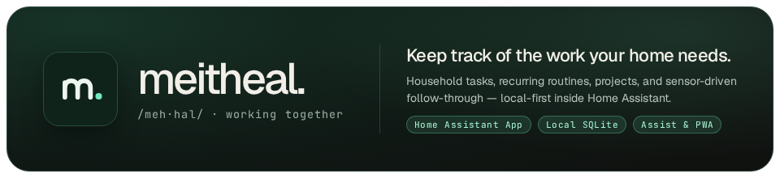
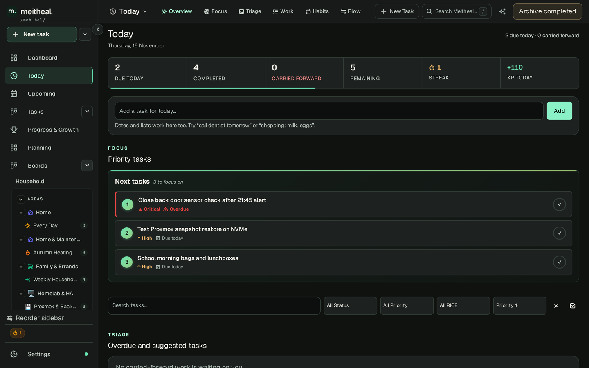
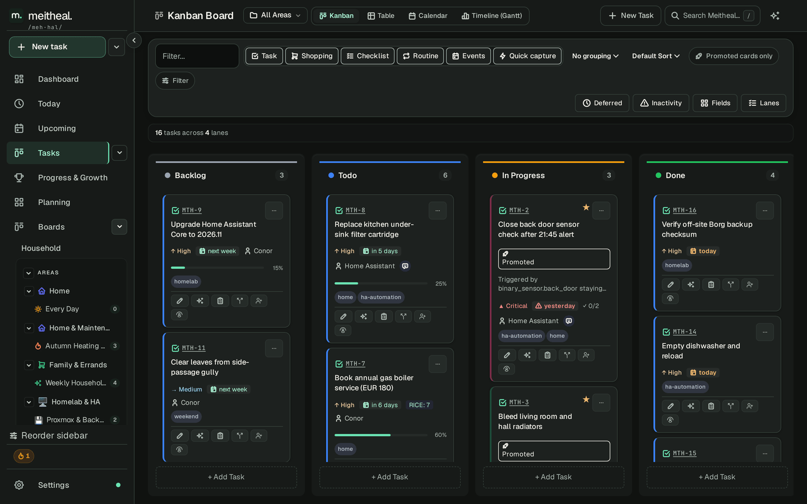

# Meitheal Canary

Preview builds of Meitheal, the household task hub for Home Assistant.

> ⚠️ **Canary is a testing channel.** Builds come straight from the latest source and may be unstable, break, or lose data. Use the **Meitheal** app for everyday use, and keep backups if you run Canary.

## About Canary

Meitheal Canary lets you try upcoming features and fixes before they reach a tagged Stable release. Each build is versioned by the source commit it was built from, so the version on this page tells you exactly which code you are running.

Canary is a separate app (`meitheal_canary`) with its own container and its own data directory. Its tasks and settings are not shared with the Stable **Meitheal** app.

| Channel | App | Best for | Versions |
|---|---|---|---|
| Stable | **Meitheal** | Everyday household use | Tagged releases such as `0.0.1` |
| Canary | **Meitheal Canary** | Previewing features and checking fixes early | The source commit each build comes from |

## About Meitheal

**Meitheal** (`/meh·hal/`) is an Irish word for neighbours coming together to share the work no single person should carry alone.

Home Assistant already knows when the back door is still open at night, when the water filter reaches six months, or when a frost warning is due. Meitheal turns those signals, together with family routines, seasonal maintenance and multi-step home projects, into one calm, local-first task hub in your Home Assistant sidebar. Everything is stored in SQLite on your own hardware.

## Features

- 📅 **Today view**: due work, recurring routines, carried-forward items and an evening wrap-up in one focused screen.
- 🗂️ **Plan your way**: switch between **Kanban**, **Table**, **Calendar** and **Timeline**, and group work by **Area**, **Goal** and **Project**.
- 🔁 **Routines**: daily and weekly templates that create real tasks with step-by-step checklists.
- 🔎 **Search Hub**: press `/` or `Ctrl/Cmd + K` to jump to any task, project, area, view or setting.
- 🏠 **Home Assistant native**: runs behind Ingress in your sidebar, with two-way calendar sync and to-do list sync.
- 🗣️ **Assist and automations**: the optional Meitheal integration adds `todo.meitheal_tasks`, task sensors, actions such as `meitheal.create_task`, and voice sentences in English and Irish.
- 🤖 **Agents and automation tools**: scoped API tokens for webhooks, n8n, Node-RED and MCP clients.
- 📱 **Any screen, even offline**: works in the Companion app, and installs as a PWA that queues changes while offline.
- 🔒 **Your data stays home**: a local SQLite database included in Home Assistant backups, with JSON, CSV and SQLite exports at any time.

## What you can track

| Household need | Example task | How Home Assistant helps |
|---|---|---|
| Sensor follow-up | *Close the back door, still open after the 21:45 check* | An automation calls `meitheal.create_task` when the sensor stays open |
| Shared routines | *School morning bags: lunch, books and PE kit* | A weekday routine creates the task with its checklist |
| Preventive maintenance | *Replace the under-sink water filter cartridge* | The due date syncs to your Home Assistant calendar and `todo.meitheal_tasks` |
| Seasonal projects | *Winter boiler and heating prep* | Quotes, radiator bleeding and pressure checks tracked on a Kanban board |

## Screenshots

| Today | Kanban |
|---|---|
|  |  |

## Installation

1. Open **Settings → Apps → Install app** in Home Assistant (**Settings → Add-ons → Add-on Store** on older releases).
2. Open the **⋮** menu, select **Repositories**, and add `https://github.com/ryan-winkler/meitheal-ha-addon`.
3. Select **Meitheal Canary**, then **Install**.
4. Select **Start**, turn on **Show in sidebar**, and select **Open web UI**.
5. Add your first task in **Today**.

The **Documentation** tab covers configuration, the Home Assistant integration, calendars, Assist and the Companion app in full.

## Data and backups

All Meitheal Canary data lives in the app's data directory:

- The task database (`/data/meitheal.db`), with your tasks, projects, routines and settings
- Scoped API tokens and local audit records

Meitheal uses cold backups, so Home Assistant stops the app briefly and every SQLite write is flushed before the backup is taken. A Home Assistant backup of the Meitheal Canary app therefore includes all of its data. Canary updates often, so make a backup before every update, and before switching between Canary and Stable, so you can always restore the previous build.

Changes made offline in the PWA stay in your browser until they sync, and are not part of Home Assistant backups until then.

## Requirements

- Home Assistant OS or Supervised, on an `amd64` or `aarch64` machine
- Ingress (built in) for sidebar access; HTTPS is needed only to install the PWA

## Troubleshooting

- **The Info tab shows an older version**: open the **⋮** menu in the app store and select **Check for updates**.
- **The app restarts on its own**: the watchdog restarts Meitheal when `/api/health` stops answering. Check the **Log** tab for the reason, and raise `log_level` to `debug` if you need more detail.
- **Meitheal cannot reach Home Assistant**: restart the app, then check the **Log** tab for Home Assistant connection errors. Meitheal reaches Home Assistant through the Supervisor, so no URL or token needs to be entered for the app itself.
- **The web UI shows an old version after updating**: accept the update prompt in Meitheal, or hard refresh with `Ctrl+Shift+R`.

More fixes are in the [troubleshooting guide](https://github.com/ryan-winkler/meitheal/blob/dev/docs/kcs/troubleshooting.md).

## Feedback and contributing

Canary exists to find problems early, so reports are especially welcome. Include the Canary version from this page, your Home Assistant Core and Supervisor versions, and the steps that led to the problem, with tokens and personal details removed.

- 🐛 [Report a bug](https://github.com/ryan-winkler/meitheal-ha-addon/issues)
- 💡 [Suggest a feature](https://github.com/ryan-winkler/meitheal/issues/new?template=feature_request.yml)
- 🔧 [Submit a pull request](https://github.com/ryan-winkler/meitheal/blob/dev/CONTRIBUTING.md)
- 📝 [Improve the documentation](https://github.com/ryan-winkler/meitheal/tree/dev/docs)
- 🔐 [Report a security problem privately](https://github.com/ryan-winkler/meitheal/blob/dev/SECURITY.md)

Visit [meitheal.io](https://meitheal.io) or the [source repository](https://github.com/ryan-winkler/meitheal) to learn more. You can support development through [GitHub Sponsors](https://github.com/sponsors/ryan-winkler) or [Ko-fi](https://ko-fi.com/ryanw_eu).

## License

Meitheal is free software under the [GNU Affero General Public License v3.0 only](https://github.com/ryan-winkler/meitheal/blob/dev/LICENSE). A [commercial license](https://github.com/ryan-winkler/meitheal/blob/dev/COMMERCIAL.md) is available for uses that cannot meet its terms.
