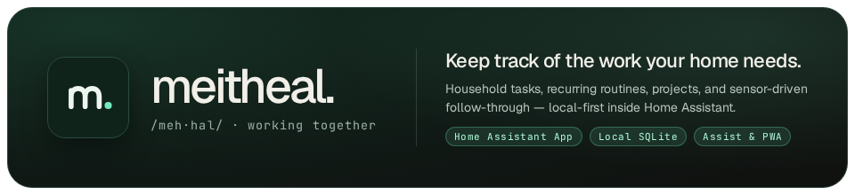
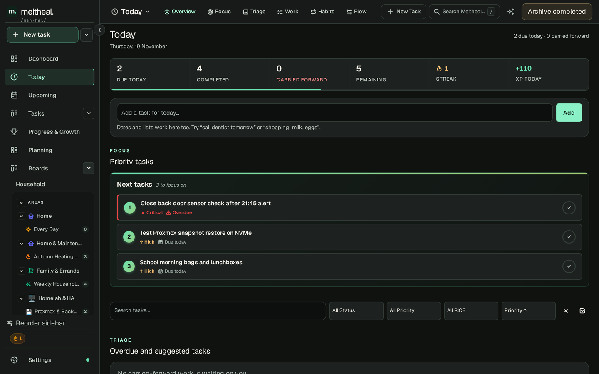
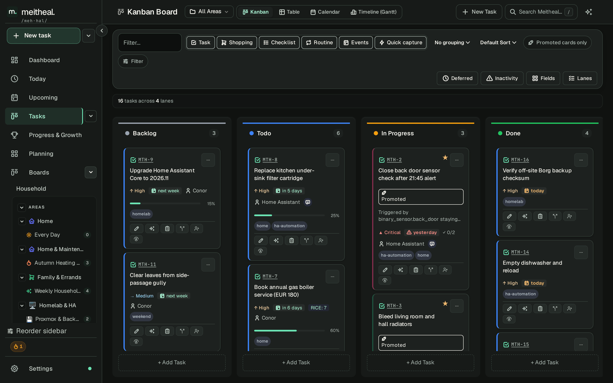

# Meitheal

Household tasks, routines and projects in your Home Assistant sidebar.

## About Meitheal

Meitheal (say "meh-hal") is an Irish word for a group of neighbours who work together on a job, such as the harvest.

Meitheal is a task manager that runs as a Home Assistant app. Use it for jobs around the house, daily and weekly routines, seasonal maintenance and larger projects. Home Assistant automations can also add tasks. For example, a door sensor can add a task when the back door stays open at night.

Meitheal keeps all data in a SQLite database on your Home Assistant machine. It does not send your tasks to a cloud service.

## Features

- **Today**: Shows the tasks that are due, your routines and the tasks from earlier days that are not done. An evening summary shows what you completed.
- **Views**: Show your tasks as a Kanban board, a table, a calendar or a timeline. Put tasks into areas, goals and projects.
- **Routines**: Make daily and weekly templates. Each template makes real tasks, with a checklist for each step.
- **Search**: Press `/` or `Ctrl+K` (`Cmd+K` on a Mac) to find a task, project, area, view or setting.
- **Home Assistant**: Meitheal opens in the sidebar through Ingress. It can sync tasks with your Home Assistant calendars and to-do lists in two directions.
- **Assist and automations**: The optional Meitheal integration adds the `todo.meitheal_tasks` entity, task sensors and actions such as `meitheal.create_task`. It also adds voice commands for Assist in English and Irish.
- **API tokens**: Give webhooks, n8n, Node-RED and MCP clients their own tokens, each with limited permissions.
- **Phone and offline use**: Meitheal works in the Home Assistant Companion app. You can also install it as a PWA. The PWA keeps your changes when you are offline and sends them when you connect again.
- **Your data**: Home Assistant backups include the database. You can export your data as JSON, CSV or SQLite at any time.

## Examples

| Job | Example task | What Home Assistant does |
|---|---|---|
| Sensor follow-up | *Close the back door. It was open at the 21:45 check.* | An automation calls `meitheal.create_task` when the door sensor stays open. |
| Shared routine | *Pack the school bags: lunch, books and PE kit.* | A weekday routine makes the task and its checklist. |
| Maintenance | *Replace the water filter under the kitchen sink.* | The due date shows in your Home Assistant calendar and in `todo.meitheal_tasks`. |
| Seasonal project | *Get the boiler and heating ready for winter.* | A Kanban board holds the quotes, the radiator bleeding and the pressure check. |

## Screenshots

| Today | Kanban |
|---|---|
|  |  |

## Installation

1. In Home Assistant, go to **Settings → Apps → Install app**. On older versions, go to **Settings → Add-ons → Add-on Store**.
2. Open the **⋮** menu and select **Repositories**.
3. Add `https://github.com/ryan-winkler/meitheal-ha-addon`.
4. Select **Meitheal**, then select **Install**.
5. Select **Start**.
6. Set **Show in sidebar** to on, then select **Open web UI**.
7. In **Today**, add your first task.

The **Documentation** tab tells you how to set up the integration, calendars, Assist and the Companion app.

## Data and backups

Meitheal keeps all of its data in the app data folder:

- The database (`/data/meitheal.db`). It holds your tasks, projects, routines and settings.
- Your API tokens and the local audit log.

Meitheal uses cold backups. Home Assistant stops the app for a short time, so that all database writes are complete before the backup starts. Thus a Home Assistant backup of Meitheal holds all of your Meitheal data.

Make a backup before each update. Then you can go back to the previous version if you have a problem.

> **Note:** The PWA keeps offline changes in your browser until they sync. Home Assistant backups do not include these changes until they sync.

## Requirements

- Home Assistant OS or Home Assistant Supervised
- An `amd64` or `aarch64` machine
- HTTPS, but only if you want to install the PWA. The sidebar uses Ingress and does not need HTTPS.

## Troubleshooting

- **The Info tab shows an old version.** Open the **⋮** menu in the app store and select **Check for updates**.
- **The app restarts by itself.** The watchdog restarts Meitheal when `/api/health` does not reply. Look in the **Log** tab for the cause. For more detail, set `log_level` to `debug`.
- **Meitheal cannot connect to Home Assistant.** Restart the app, then look for connection errors in the **Log** tab. The app connects through the Supervisor, so you do not need to give it a URL or a token.
- **The web UI shows an old version after an update.** Accept the update message in Meitheal, or press `Ctrl+Shift+R` to reload the page.

The [troubleshooting guide](https://github.com/ryan-winkler/meitheal/blob/dev/docs/kcs/troubleshooting.md) has more solutions.

## Contributing

Meitheal is open source. You can help in these ways:

- [Report a bug](https://github.com/ryan-winkler/meitheal-ha-addon/issues)
- [Ask for a feature](https://github.com/ryan-winkler/meitheal/issues/new?template=feature_request.yml)
- [Send a pull request](https://github.com/ryan-winkler/meitheal/blob/dev/CONTRIBUTING.md)
- [Make the documentation better](https://github.com/ryan-winkler/meitheal/tree/dev/docs)
- [Tell us about a security problem privately](https://github.com/ryan-winkler/meitheal/blob/dev/SECURITY.md)

For more information, go to [meitheal.io](https://meitheal.io) or the [source code](https://github.com/ryan-winkler/meitheal). To support the work, use [GitHub Sponsors](https://github.com/sponsors/ryan-winkler) or [Ko-fi](https://ko-fi.com/ryanw_eu).

## License

Meitheal is free software under the [GNU Affero General Public License v3.0 only](https://github.com/ryan-winkler/meitheal/blob/dev/LICENSE). If you cannot agree to its terms, you can get a [commercial license](https://github.com/ryan-winkler/meitheal/blob/dev/COMMERCIAL.md).
